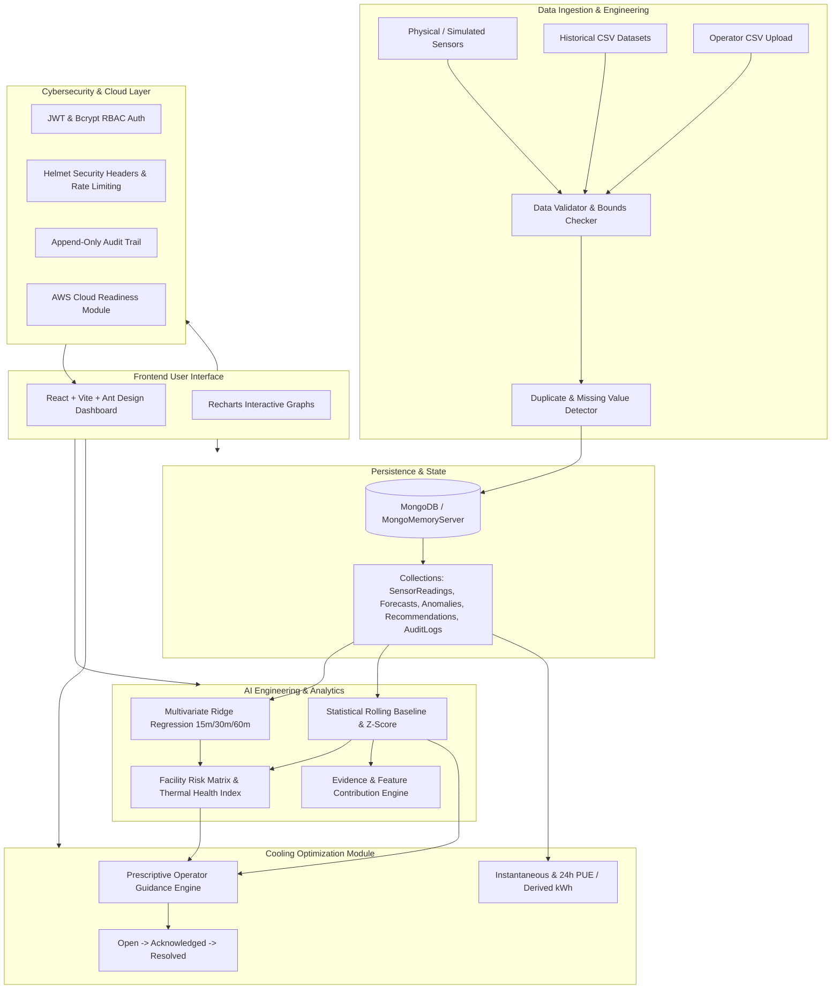

# ThermalMind: System Architecture & Design Specification

## 1. System Overview

**ThermalMind** is an enterprise data center thermal monitoring, predictive forecasting, and cooling optimization platform designed to maintain compute reliability, identify hotspots, and provide actionable HVAC guidance to data center operators.

The system incorporates physics-informed machine learning, statistical anomaly detection, data engineering pipelines, role-based cybersecurity controls, and cloud-ready infrastructure.

---

## 2. Module Specifications

### 2.1 Data Engineering Module
- **Physical Bounds Validation**: Enforces physical boundaries (e.g. Temperature between -10°C and 100°C; Power between 0W and 3000W; CPU between 0% and 100%).
- **Duplicate & Missing Values**: Detects timestamp collisions and attributes per-server telemetry with rejection reporting.
- **Configurable Simulator**: Models thermodynamics:
  $$\text{Heat Generation} \propto \frac{P_{\text{watts}}}{450} \times 15^\circ\text{C}$$
  $$\text{Cooling Dissipation} \propto \frac{\text{RPM}}{100} \times 11^\circ\text{C} \times \text{Capacity Factor}$$
  Includes damping thermal inertia:
  $$T_{t+1} = 0.82 \cdot T_t + 0.18 \cdot T_{\text{equilibrium}} + \Delta_{\text{scenario}}$$

### 2.2 AI Engineering Module
- **Multivariate Ridge Regression**: Solves normal equations analytically with $L_2$ regularization:
  $$w = (X^T X + \lambda I)^{-1} X^T y$$
- **Horizons**: Multi-horizon predictions for 15, 30, and 60 minutes.
- **Chronological Split**: 80% train / 20% test to prevent temporal data leakage.
- **Evaluation Metrics**: Real MAE and RMSE calculated across test partitions.
- **Statistical Anomaly Detection**:
  - $Z$-score deviation from rolling $N=20$ sample baseline:
    $$Z = \frac{T - \mu}{\sigma}$$
  - Multi-heuristic checks: `CRITICAL_HOTSPOT` ($T \ge 38^\circ\text{C}$), `SUDDEN_SPIKE` ($\Delta T > 4.5^\circ\text{C}$), `COOLING_DEGRADATION` ($\text{Fan} \ge 88\% \land T \ge 32^\circ\text{C}$), `WORKLOAD_MISMATCH` ($T \ge 29.5^\circ\text{C} \land \text{CPU} < 25\%$).

### 2.3 Cooling Optimization Module
- Prescriptive operator recommendations with severity badges (`Critical`, `High`, `Medium`, `Low`).
- Operator lifecycle: Open $\rightarrow$ Acknowledged $\rightarrow$ Resolved with mandatory mitigation notes.
- PUE and energy integration:
  $$E = \int P(t) \, dt \approx \sum P_{\text{avg}} \cdot \Delta t$$

### 2.4 Security & Cloud Layer
- Role-Based Access Control (RBAC): `Administrator` vs `Operator`.
- Rate limiting, Helmet security headers, password hashing via bcrypt (10 rounds).
- Append-only structured audit logging for administrative actions.
- AWS cloud readiness module indicating `Local Mode — AWS Not Configured` without mock infrastructure.
